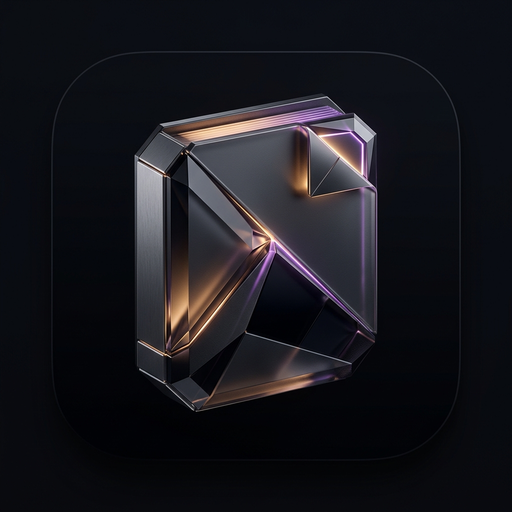
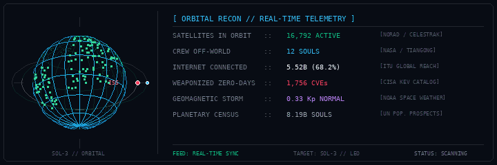

# Ayush (`@ayush-rdev`)

### *Building local-first architectures, distributed systems & high-performance native software.*

 

---

### 🏛️ Featured Engineering: [Monolith Notes](https://github.com/ayush-rdev/monolith-notes)

<table>
  <tr>
    <td width="130" align="center" valign="middle">
      
    </td>
    <td>
      <h3><a href="https://github.com/ayush-rdev/monolith-notes">Monolith Notes</a> — Distraction-Free Knowledge Graph</h3>
      

        An ultra-minimal markdown journal & personal knowledge graph built on <b>pure local file sovereignty ("File Over App")</b>. 100% interoperable with Obsidian, zero subscriptions, zero proprietary databases, and zero telemetry.
      

      

        <b>Core Architecture:</b> Native <b>Jetpack Compose</b> (Android) + <b>Tauri v2 / Rust</b> (macOS, Windows, Linux) • 120Hz Force-Directed Galaxy Topology • Local Synaptic Spreading Activation AI RAG • Multi-Protocol E2EE Sync (Google Drive, WebDAV, Monolith Cloud) • Hardware Biometric Shield.
      

      

        <a href="https://github.com/ayush-rdev/monolith-notes/releases/tag/v2.7.0"><b>⬇️ Download v2.7.0 (Android APK, DEB, RPM, DMG, EXE)</b></a> • <a href="https://github.com/ayush-rdev/monolith-notes"><b>View Source Code →</b></a>
      

    </td>
  </tr>
</table>

---

### 🛠️ Open-Source Ecosystem

| Project | Description | Stack |
| :--- | :--- | :--- |
| **[monolith-notes](https://github.com/ayush-rdev/monolith-notes)** | Ultra-minimal, distraction-free markdown journal & personal knowledge graph with local file sovereignty | `Kotlin` `Compose` `Rust` `Tauri v2` `React 19` |
| **[kalideck](https://github.com/ayush-rdev/kalideck)** | Self-hosted web console for Kali Linux labs: real terminals, tool catalogs, Docker, and VPN/Tor | `Python` `WebSockets` `Docker` `Linux` |
| **[omarchy-macos-theme](https://github.com/ayush-rdev/omarchy-macos-theme)** | macOS Sequoia dark theme for Omarchy & Hyprland — frosted glass blur, Apple springs, SF typography | `Hyprland` `CSS` `Shell` `Wayland` |
| **[omarchy-hacker-theme](https://github.com/ayush-rdev/omarchy-hacker-theme)** | Cyberpunk dark hacker aesthetic for Omarchy and Hyprland with curated 4K/5K wallpapers | `Hyprland` `Theme` `Wayland` |
| **[ayushwrites](https://github.com/ayush-rdev/ayushwrites)** | Personal publication & technical essays on engineering, distributed systems, and philosophy | `Astro` `TypeScript` `Tailwind` |

---

### 📡 Telemetry & Direct Link

- **Inquiries & Architecture:** [Ayushr.in@proton.me](mailto:Ayushr.in@proton.me)
- **GitHub:** [@ayush-rdev](https://github.com/ayush-rdev)

 

  
    
  <i>ASCEND 🩵</i>

